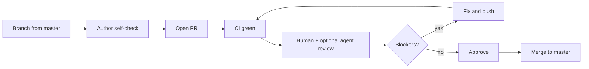

# Code review workflow

How contributors and reviewers ship changes to Compliance Review Copilot without weakening security, auditability, or product contracts.

**Canonical references:** [`AGENTS.md`](../AGENTS.md), [`ACCEPTANCE-CRITERIA.md`](ACCEPTANCE-CRITERIA.md), [`ai/build/AGENTS.md`](../ai/build/AGENTS.md), `.cursor/rules/`, and the build skill [`ai/build/skills/code-review/SKILL.md`](../ai/build/skills/code-review/SKILL.md) for agent-assisted reviews.

## Roles

| Role | Responsibility |
|------|----------------|
| **Author** | Small PRs, self-check commands, link AC IDs in tests, respond to feedback |
| **Human reviewer** | AuthZ, tenancy, logging redaction, WS contracts, UI compliance copy, eval when AI changes |
| **CI** | Required checks on every PR (see [Automated gates](#automated-gates)) |
| **Coding agent** (optional) | Runs the code-review skill, Bugbot, or security review on request — never merges |

## Lifecycle



## Before you open a PR

1. **Scope** — One logical change. Split infra, product behaviour, and refactors when possible.
2. **Sync** — `git fetch` and rebase or merge `master` so the PR diff is reviewable.
3. **Local gates** (from repo root):

```bash
make lint
make test
make packs-validate
pnpm -C apps/web typecheck
pnpm -C apps/web lint
```

4. **Schemas** — If you touched `ai/agents/schemas/` or `packages/schemas/`, run `make schemas` and commit generated types.
5. **Migrations** — Schema changes need reversible Alembic migrations under `database/alembic/` (when present).
6. **Tests** — New behaviour gets tests; name tests after AC IDs where applicable (`test_ac_auth_02_...`).
7. **PR description** — Summary, test plan, linked issues, and explicit callouts for security, auth, prompts, packs, or infra.

## Automated gates

GitHub Actions workflow [`.github/workflows/ci.yml`](../.github/workflows/ci.yml) runs on every pull request:

| Job | What it enforces |
|-----|------------------|
| **python** | `ruff check`, `ruff format --check`, `pytest -q` |
| **packs** | `make packs-validate` |
| **web** | `pnpm typecheck` and `eslint` in `apps/web` |

**Path-triggered (future / manual today):**

- **Eval smoke** — Required when changing `packages/complibot/src/complibot_worker/pipeline/`, worker prompts, `ai/frameworks/`, or `ai/rules/runtime-config.yaml`. See [`ai/build/skills/run-eval-harness/SKILL.md`](../ai/build/skills/run-eval-harness/SKILL.md).
- **Terraform plan** — Comment or job when `infra/terraform/` changes (see [`docs/deploy/aws/17-cicd-github-actions.md`](deploy/aws/17-cicd-github-actions.md)).

CI must be green before merge. Do not bypass failing checks without a tracked follow-up and reviewer agreement.

## Human review checklist

Use this as a PR comment template or mental model. **Block merge** on any “must” failure.

### Always (every PR)

- [ ] **Tenancy and auth** — Every new REST route, WS handler, presigned URL, report download, and sign-off path checks tenant, project membership, and role server-side. Cross-tenant access returns **404**, not 403 (AC-AUTH-02).
- [ ] **Logging** — No document text, quotes, prompts, completions, rationale, comment bodies, or JWTs in logs. Only ids, hashes, lengths, durations, token counts (`structlog` + redaction).
- [ ] **Audit trail** — Review decisions and other audit events are append-only; no update/delete APIs for audit rows.
- [ ] **Dependencies** — New Python or npm deps need a one-line justification in the PR; no unaudited additions in demo deploy paths.
- [ ] **Legal / demo copy** — Findings, remediations, and reports still show the disclaimer from `ai/rules/02`. Upload surfaces still show the demo-data notice (AC-UPL-07, D-08).

### By area

| Paths touched | Focus |
|---------------|--------|
| `packages/complibot/src/complibot/routers/`, `auth`, `ws/` | JWT validation, role matrix, input size limits |
| `packages/complibot/src/complibot_worker/` | Citation verifier, no auto-accept (AC-AI-08), `llm.client.invoke` only, document wrapping |
| `ai/agents/`, `ai/frameworks/`, worker prompts | Spec and code in same PR; eval smoke; `PROMPT_VERSION` bumps |
| `packages/schemas/`, `ai/agents/schemas/events.yaml` | `make schemas`, contract tests, frontend reducer + replay |
| `apps/web/` | CSP, no `dangerouslySetInnerHTML` for document content, a11y, both themes |
| `infra/terraform/` | Checkov, least privilege, secrets not in state plaintext |
| `docker-compose*.yml`, deploy docs | Demo rejects OpenRouter; network and secret handling |

Cursor rules under `.cursor/rules/` expand each area; reviewers should spot-check against the relevant rule file.

## Agent-assisted review

Use agents to **supplement**, not replace, human review on security-sensitive code.

| Tool | When to use |
|------|-------------|
| **Code-review skill** | Broad PR pass: map diff to checklist above, cite file:line findings |
| **Bugbot** (`/review-bugbot` or `bugbot` subagent) | Logic bugs, race conditions, error handling |
| **Security review** subagent | Auth, injection, SSRF, secrets, tenant isolation |

**Prompt shape for Bugbot / security review:**

```text
Full Repository Path: /absolute/path/to/complibot
Diff: branch changes
Custom Instructions: Focus on AC-AUTH-02, logging redaction, and citation verifier bypasses.
```

Agents must not approve or merge PRs. Findings go in the PR as comments; the human reviewer decides.

## Severity rubric for review comments

| Label | Meaning | Merge |
|-------|---------|-------|
| **blocker** | Security, tenancy, data leak, audit break, or AC violation | Must fix |
| **major** | Incorrect behaviour, missing tests for critical path | Fix or documented follow-up with issue |
| **minor** | Style, naming, non-critical edge cases | Author discretion |
| **nit** | Preference | Optional |

## Merge criteria

- At least **one** human approval from someone other than the author (or team policy equivalent).
- All required CI checks green.
- No open **blocker** review threads.
- AI/pack changes: eval smoke run or explicit waiver with issue link.
- Deploy-only PRs: test plan includes target environment verification steps.

## After merge

- Delete the branch when GitHub offers it.
- If the change affects demo AWS or Vercel, follow the deploy runbook in [`docs/deploy/aws/README.md`](deploy/aws/README.md).
- Watch release channels for regressions; file issues with AC IDs when behaviour diverges from [`ACCEPTANCE-CRITERIA.md`](ACCEPTANCE-CRITERIA.md).
